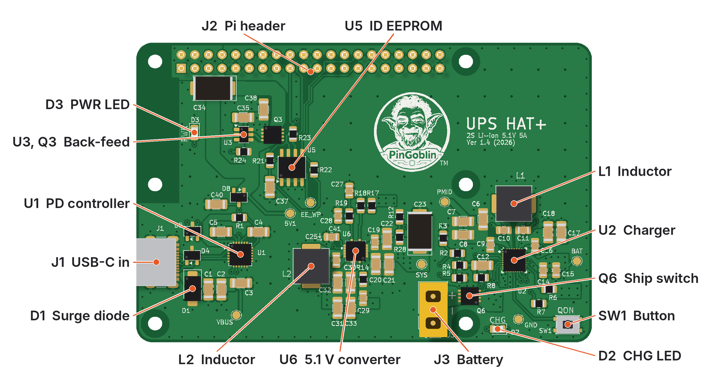

# Board overview

Power flows in one direction: USB-C input → charger → system rail (shared with the battery) → 5.1 V converter → back-feed blocker → Pi header. When USB-C power is removed, the battery feeds the system rail instead, with no gap in the output.

*Top view of the Rev D board (Ver 1.4), rendered from the production Gerber files. The 40-pin header J2 is fitted underneath; only its pins show on top. The battery protection is on the UPS Pack board, not on the HAT.*

**Connectors, controls and indicators**

| Label | Item | What it does |
| --- | --- | --- |
| J1 | USB-C input | Connect a USB-C power adapter here. Power only, no data. |
| J2 | 40-pin header | Connects to the Raspberry Pi. Supplies 5.1 V and carries I²C. |
| J3 | Battery connector (XT30, male) | Takes the pack's XT30 plug: pad 1 GND (−), pad 2 battery +. |
| SW1 | Power button (marked QON) | Short press: wakes the board from its off (ship) state. Long press (about 15 s): resets power to the Pi. |
| D2 | Green LED (marked CHG) | On: charging. Off: charge complete or no input. Blinking: charge fault. |
| D3 | Green LED (marked PWR) | On: 5.1 V output to the Pi is active. |
| VBUS, PMID, SYS, BAT, 5V1, GND, EE_WP | Test pads | For service measurements, each marked with its signal: USB-C input, charger input, system rail, battery, 5.1 V output, ground and EEPROM write-protect. |

**Battery connector J3 (XT30)**

| Pad | Connect to |
| --- | --- |
| 1 (square) | Pack − |
| 2 | Pack + |

The XT30 plug fits only one way round. It enters from above; to unplug, pull on the plug, not the lead.

**UPS Pack board**

| Label | Item | What it does |
| --- | --- | --- |
| SW1 | On/off slide switch | OFF switches the pack output off completely (storage and transport). ON enables it; on the HAT, the output returns the next time the HAT has USB-C power |
| BT1, BT2 (DUAL); BT1–BT4 (QUAD) | 18650 holders | BT1 (and BT3) is cell 1, BT2 (and BT4) is cell 2. BT2 and BT4 face the other way: follow the + marks |
| J1 | Lead pads | The 18 AWG lead to the XT30 plug: pad 1 P− (black), pad 2 P+ (red) |
| RT1 (and RT2 on the QUAD) | Temperature sensors | Under the gap pads between the holders; they switch the pack off above about 60 °C |
| TP1–TP5 | Test pads | Service measurements: cell −, midpoint, cell +, output −, output + |

**Key components**

| Function | Part | Role |
| --- | --- | --- |
| USB-C PD controller | ST STUSB4500 | Negotiates 5 V, 9 V or 15 V from the adapter. |
| Battery charger and monitor | TI BQ25798 | Charges the cells, switches between input and battery, measures voltages and currents, and provides the off (ship) mode. |
| Ship switch | MOSFET Q6 | Disconnects the battery from the HAT in ship mode, under the charger's control. |
| 5.1 V converter | TI TPS54620 | Steps the system voltage down to a regulated 5.1 V at up to 5 A. |
| Back-feed blocker | Diodes AP74700 with MOSFET | Stops current flowing back into the board from the Pi's own USB-C supply. |
| PD controller supply | BAT54S diode | Powers the PD controller from the 5 V rail, so its I²C pins never hold the Pi's bus low, even when the board is off and the Pi runs from its own supply. |
| HAT+ ID EEPROM | onsemi CAT24C32 | Identifies the board to the Raspberry Pi. |
| Surge and ESD protection | SMAJ16A, PESD24VS2, PESD5V0X2 | Protects the USB-C input from voltage spikes and static discharge. |
| Battery protector (pack board) | HYCON HY2120 with two MOSFETs | Watches each cell and disconnects the pack on over-charge, over-discharge or over-current. Two small MOSFETs (2N7002) override it when the switch or the temperature cut-off turns the pack off. |
| Cell balancers (pack board) | HYCON HY2213, one per cell | Bleeds a cell above 4.20 V so the cells stay matched. |
| Temperature cut-off (pack board) | LM393 comparator with NTC sensors | Switches the pack off above about 60 °C. |
| Pack fuse (pack board) | 10 A SMD fuse (2410) | Protects the cells and wiring from short circuits. |
