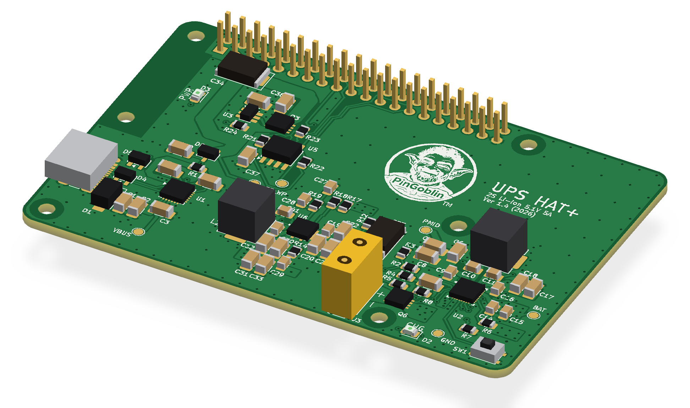

# UPS HAT+ User Manual

The UPS HAT+ keeps a Raspberry Pi running from a 2-cell (2S) lithium-ion battery when mains power fails, and shuts the Pi down cleanly before the battery runs flat. It powers the Pi through the 40-pin header at 5.1 V and up to 5 A, so a Raspberry Pi 5 can run at full load with USB peripherals attached.

This manual covers the UPS HAT+ hardware revision D and its battery, the UPS Pack board Rev B (DUAL or QUAD). Read the [safety section](safety.md) before connecting a battery.

*UPS HAT+ Rev D on standoffs. Preliminary render from an earlier placement plan: it still shows the old 4-way battery terminal. Production boards have the XT30 battery connector J3 at the bottom edge.*

## Contents

- [Key features](key-features.md)
- [Specifications](specifications.md)
- [Compatibility](compatibility.md)
- [Power sources](power-sources.md)
- [What's in the box](in-the-box.md)
- [Important safety information](safety.md)
- [Board overview](board-overview.md)
- [Battery requirements](battery.md)
- [Installation](installation.md)
- [Raspberry Pi configuration](pi-configuration.md)
- [Operation](operation.md)
- [Software](software.md)
- [Troubleshooting](troubleshooting.md)
- [Shipping, storage and disposal](shipping-storage.md)
- [Appendix A: Electrical characteristics](appendix-a.md)
- [Appendix B: UPS HAT+ technical information](appendix-b.md)
- [Appendix C: UPS Pack technical information](appendix-c.md)
